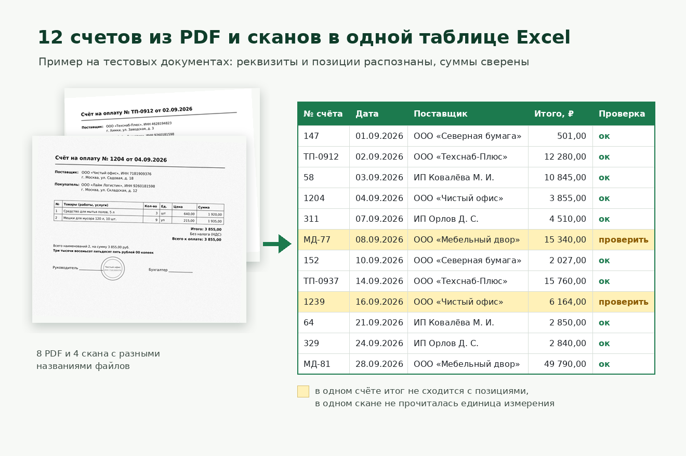

# Счета из PDF и сканов в Excel

Скрипт разбирает папку со счетами — PDF, сканы и фото с телефона — и собирает одну таблицу Excel: номер, дата, поставщик, ИНН, покупатель, позиции и итоги. Суммы сверяются формулами прямо в таблице, а всё сомнительное подсвечивается жёлтым с пометкой «проверить».



## Как устроено

- PDF с текстовым слоем читаются напрямую через pdfplumber.
- Сканы и фото распознаёт Tesseract. Перед распознаванием OpenCV стирает линии таблиц: с ними Tesseract теряет строки товаров.
- Номера, даты, ИНН и позиции достаются регулярными выражениями, которые терпимы к типичным ошибкам OCR (перепутанные О и 0, лишние пробелы в суммах).
- В Excel три листа: счета, позиции и описание файла. Итоги пересчитываются формулами, расхождения подсвечиваются условным форматированием.
- Всё работает локально: документы никуда не отправляются.

## Пример

В `examples/входящие_счета` лежат 12 тестовых счетов: 8 PDF и 4 скана. Все реквизиты вымышленные, их генерирует `gen_invoices.py`, а в один счёт специально заложена ошибка в итоге. Результат — `examples/Счета_сентябрь.xlsx`: 10 счетов «ок» и 2 «проверить». В одном не сходится сумма, в другом OCR не прочитал единицу измерения на скане.

## Запуск

```
pip install -r requirements.txt
python extract_invoices.py examples/входящие_счета Счета.xlsx
```

Нужен Tesseract с русским языком. На Windows путь к нему можно задать так: `set TESSERACT_CMD=C:\Program Files\Tesseract-OCR\tesseract.exe`.

Для генерации тестовых счетов дополнительно нужны `reportlab` и `num2words`.

## Ограничения

Шаблоны поиска настроены под типовые российские счета. Для других форм документов их нужно подправить: они собраны в начале `extract_invoices.py` (`RE_HEAD`, `RE_SUPPLIER`, `RE_BUYER`, `RE_ITEM`, `UNITS`).
